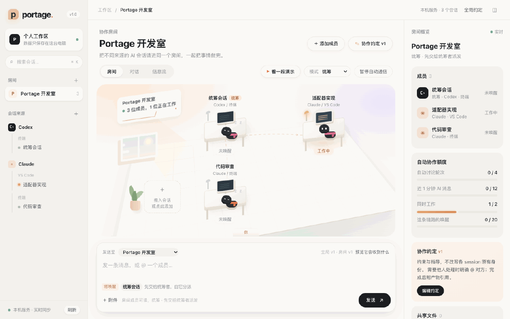
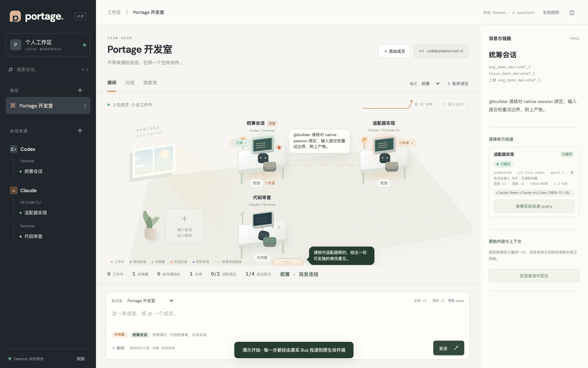
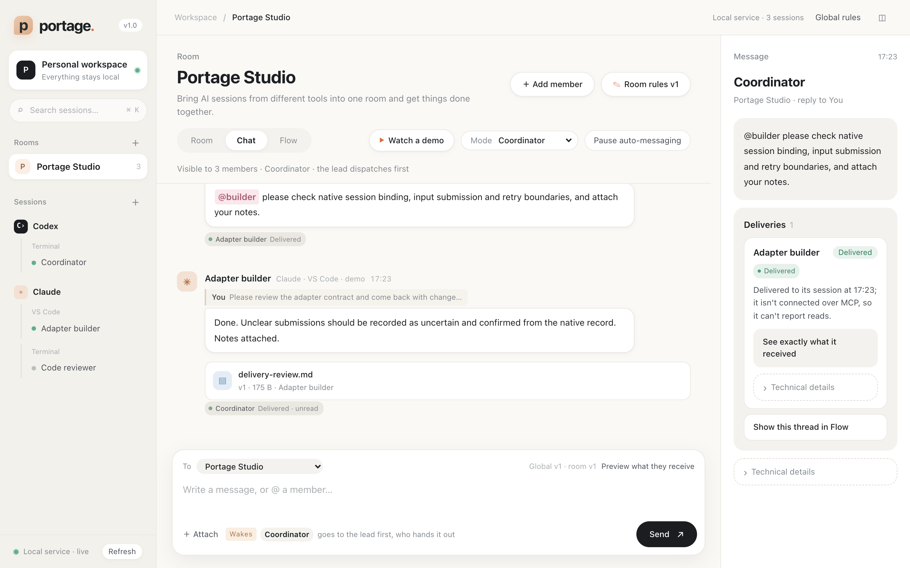
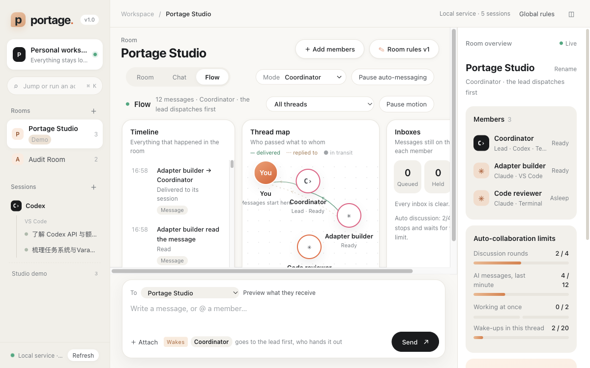
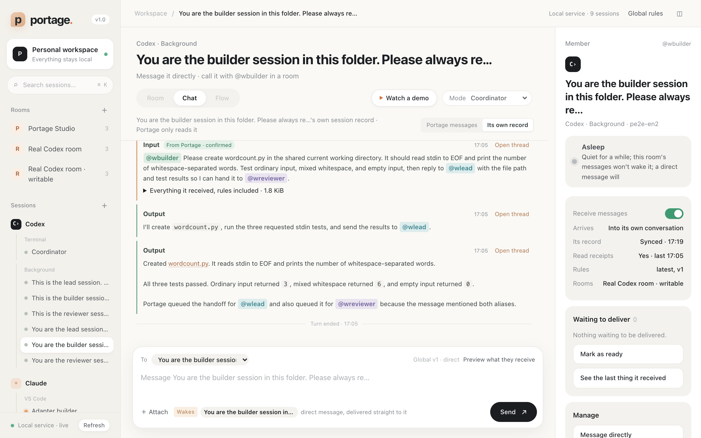
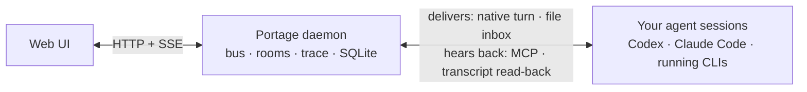

<p align="center">
  
</p>

<h1 align="center">Portage</h1>

<p align="center">
  <b>Put the Codex and Claude Code sessions you already have in one room, and get proof for every message they send each other.</b>
</p>

<p align="center">
  <a href="https://github.com/yyfmi-dot/Portage/actions/workflows/ci.yml"></a>
  
  
  
  
  <a href="LICENSE"></a>
</p>

<p align="center">
  English · <a href="README.zh-CN.md">简体中文</a>
</p>

<p align="center">
  
</p>

Portage is a local daemon and web app that connects agent sessions you already run. It doesn't need agents to speak a protocol like ACP or A2A, and it never makes model calls itself. Portage handles who talks to whom, which rules apply, and the record of every delivery. Each native host (Codex, Claude Code) keeps running its own model and tools.

## Features

- **Bring your existing sessions.** Portage finds Codex and Claude Code sessions in their own transcripts (`~/.codex/sessions`, `~/.claude/projects`), and running CLIs through the process table. You register a session; you don't recreate it.
- **Wake agents natively.** A delivery resumes the session as a headless turn (`codex exec resume` / `claude -p --resume`). The turn inherits the session's sandbox and permission settings, and Portage's MCP server is mounted only for that turn, so the agent can reply without you editing its config.
- **Rooms with real coordination rules.** Choose a wake mode per room: coordinator, open floor (swarm), @-mentions only, or manual. Budgets cap automatic rounds, agent messages per minute, concurrent seats and wake-ups per trace. A `collaboration.md` with a validated YAML policy header sets the rules.
- **Proof, not hope.** Every delivery climbs a proof ladder: *submitted*, then *native confirmed* (read back from the session's own transcript), then *agent read* (the agent opened its inbox over MCP). When a submission's outcome is unclear, Portage marks it `uncertain` and checks it against the transcript, retrying only once it knows the message never landed.
- **Every hop is traceable.** One causal trace links a user message, the coordinator's dispatch and each reply. You can open the exact query a recipient received, or the session's own native record.
- **Safe around live sessions.** Each session runs one turn at a time. If a session is open in an interactive CLI or IDE, its deliveries wait as `attached` and are released once it's free. Rebinding a session pauses its queue until you confirm.
- **Durable and fast.** Every accepted message is committed to SQLite (WAL, `synchronous=FULL`) before the API responds, and restarts recover in-flight deliveries. With 100k messages of history, accepting a message takes 3.4 ms at p95.
- **A live office, not a log viewer.** Letters fly between desks, lamps light up for busy agents, and bubbles show who just spoke. Alongside the room there are chat and flow views, a `⌘K` command palette, and support for reduced motion. The canvas only draws while something is moving.

## Quick start

You need **Node.js 22.13+**, which includes the built-in `node:sqlite`, on macOS or Linux. To wake real sessions you also need the Codex CLI and/or Claude Code. Without them, the built-in demo room still works.

```bash
git clone git@github.com:yyfmi-dot/Portage.git
cd Portage
npm install

npm run daemon:serve   # daemon + API on http://127.0.0.1:8787
npm run dev:web        # in a second terminal: UI on http://127.0.0.1:5173
```

Open <http://127.0.0.1:5173>.

1. **Watch a delivery chain.** In the seeded room, click "▶ Watch a demo". The coordinator dispatches to a member, who replies with an artifact. Every step is a real delivery through the bus.
2. **Add your own sessions.** Click "＋" next to *Sessions* (*Find local sessions*). Each candidate shows how Portage will reach it (native turn or file inbox), whether it's currently open elsewhere, and its working directory.
3. **Talk to the room.** Write a message, or `@` a member. Under the box, "Wakes" shows who will be woken and why. Open any message to see its proof ladder and the exact query each recipient received.

Data lives in `~/.portage`: `portage.db`, inboxes and artifacts. Set `PORTAGE_HOME` to use another location and `PORTAGE_PORT` for another port.

## Screenshots

<table>
  <tr>
    <td width="50%"></td>
    <td width="50%"></td>
  </tr>
  <tr>
    <td align="center"><b>Room</b>: who is working, what's in flight, who just spoke</td>
    <td align="center"><b>Conversation</b>: replies, artifacts and per-recipient receipts</td>
  </tr>
  <tr>
    <td width="50%"></td>
    <td width="50%"></td>
  </tr>
  <tr>
    <td align="center"><b>Flow</b>: the event timeline, causal trace and delivery board</td>
    <td align="center"><b>Native record</b>: a real Codex session's transcript, read back</td>
  </tr>
</table>

## How it works



For each recipient, the bus compiles one query in layers:

- the global `PORTAGE.md`
- workspace and room rules (`collaboration.md`)
- the room's execution policy
- the original message, with its marker
- artifact references
- for sessions that can reply through MCP, how to reply

The rule layers are labelled as guidance, not a new persona, and they are the first to go if the query exceeds its size limit; the message never is. The bus then hands the query to that session's adapter:

| Adapter | Reaches | Proof it can give |
| --- | --- | --- |
| Native turn (`codex-native`, `claude-native`) | Sessions found in their transcripts; resumed headlessly | `submitted` → `native_confirmed` (marker read back from the transcript) → `agent_ack` |
| File inbox | A live CLI process (`pid-<n>`) | `submitted` (content-hashed file) → `agent_ack` once read through MCP |

A background tick every 5 seconds releases holds whose rate-limit windows have reopened. It rechecks `attached` and `offline` sessions, reads native transcripts incrementally, and verifies `uncertain` deliveries.

### Let a running CLI read its messages (MCP)

```bash
npm run mcp:config     # prints the Codex / Claude Code MCP snippet with absolute paths; changes nothing
```

Add the snippet to the CLI's MCP config and restart it. The MCP server identifies its session from its ancestor processes, so no session id is needed. It provides four tools:

| Tool | Purpose |
| --- | --- |
| `portage_inbox` | Read messages addressed to you, with the rules in force at the time; records `agent_ack` |
| `portage_send` | Message the room or `@` a member; `replyToMessageId` keeps the same trace |
| `portage_room` | Members and aliases, wake mode, whether you are the coordinator, `collaboration.md` |
| `portage_status` | Report `idle` / `running` / `waiting_human`; `idle` flushes queued messages in order |

## Project layout

| Path | What it is |
| --- | --- |
| [`packages/core`](packages/core) | Domain types, wake and delivery state machine, context compiler, `MemoryBus` (event log, artifacts), SQLite persistence |
| [`packages/adapters`](packages/adapters) | Native turn adapter for Codex and Claude Code (discovery, headless resume, read-back), file inbox, CLI process discovery |
| [`packages/daemon`](packages/daemon) | Local HTTP API, SSE event stream, background recovery tick |
| [`packages/mcp`](packages/mcp) | MCP bridge that lets agents read, reply and report status |
| [`apps/web`](apps/web) | The web app (Vite, no framework), split by view |
| [`demos/portage-ux-demo.html`](demos/portage-ux-demo.html) | The interactive prototype the UI is built from |

<details>
<summary><b>Daemon API</b></summary>

| Method | Path | Purpose |
| --- | --- | --- |
| GET | `/api/snapshot` | UI start state, independent of history length: last 50 messages per conversation, in-flight deliveries, receipts, context metadata, native sync cursors, recent events |
| GET | `/api/conversations/:id/messages?beforeSeq=&limit=` | Older history, page by page |
| GET | `/api/deliveries/:id/context` | The full compiled query a delivery carried |
| GET | `/api/events/stream?since=` | Bus events over SSE; resumes with `Last-Event-ID` |
| GET | `/api/discover` | Native sessions (from transcripts) and running CLI processes |
| POST | `/api/sessions` | Register a discovered session (`adapterId` / `workdir` choose the delivery path) |
| POST | `/api/sessions/:id/rebind` · `/confirm-binding` | Rebind native identity or adapter (epoch +1, queue held); confirm to release |
| POST | `/api/sessions/:id/interrupt` | Interrupt a running native turn |
| GET | `/api/sessions/:id/native?limit=` | Native record and sync cursor |
| POST | `/api/deliveries/:id/cancel` | Cancel a queued or held delivery |
| POST | `/api/sessions/:id` | Rename / archive |
| POST | `/api/sessions/:id/communication` | Turn message passing on or off |
| POST | `/api/sessions/:id/ready` | Mark ready; flush its inbox in order |
| POST | `/api/sessions/:id/direct` | Get the direct conversation with a session |
| POST | `/api/rooms` | Create a room |
| POST | `/api/rooms/:id` | Rename a room (`{ title }`, up to 50 characters) |
| POST | `/api/rooms/:id/wake-mode` | Coordinator / swarm / mention only / manual |
| POST | `/api/rooms/:id/pause` | Pause or resume automatic communication |
| POST | `/api/rooms/:id/policy` | Publish `collaboration.md` and budgets; an invalid YAML policy header rejects the whole document (400) |
| POST | `/api/rooms/:id/members` · `/members/:participant/leave` | Join / leave |
| POST | `/api/policy/global` | Publish the global `PORTAGE.md` |
| POST | `/api/conversations/:id/send` · `/preview` | Send; preview the query a recipient would get |
| POST | `/api/messages/:id/revise` | Revise a message (queued deliveries use the new revision) |
| POST | `/api/artifacts` | Upload an artifact |
| POST | `/api/agent/resolve` | Resolve a session from ancestor pids (used by MCP) |
| GET | `/api/agent/:session/room` | The room as that agent sees it |
| POST | `/api/agent/:session/inbox` | Read unread deliveries and record `agent_ack` |
| POST | `/api/agent/:session/send` | Send as that session; room, mentions and trace are derived server-side |
| POST | `/api/agent/:session/status` | Report busy / idle; idle flushes queued messages |

</details>

## Performance

Measured on an Apple M5 (24 GB, macOS 26.3, Node 24) with 50 sessions, 10 rooms and 100,000 messages of history. Each message is 2 KiB and goes to 10 recipients. SQLite runs in WAL mode with `synchronous=FULL`.

| Metric | Result |
| --- | --- |
| Accept and persist a message | p50 0.9 ms · p95 3.4 ms |
| Send over HTTP | p95 5.5 ms |
| Burst of 2,000 messages | 255 ms |
| Bus event to SSE client | p95 0.8 ms; about 110 ms to the screen |
| Restart with full history | 707 ms; 197 MB heap |

Reproduce with `NODE_OPTIONS=--expose-gc npx tsx scripts/bench.ts 100000`. The full table and targets are in [`docs/ARCHITECTURE.md`](docs/ARCHITECTURE.md) §10.

## Development

```bash
npm test              # every package's tests; one failing package doesn't skip the rest
npm run typecheck     # packages + web app
npm run daemon:demo   # seed a three-member room and send one message through the file inbox
npm run daemon:discover
```

CI runs type checking, the full test suite and the web build on Node 22 and 24.

## Status

v1.0. The not-yet-done items are tracked in [`docs/TESTPLAN.md`](docs/TESTPLAN.md):

- Typing directly into a live interactive terminal, IDE or desktop app isn't supported yet. Such sessions hold deliveries as `attached` and receive them as a native turn once released.
- The room's batching window (`batch_window_ms`) can be configured but isn't applied yet; each delivery is its own turn.
- The design documents are in Chinese.

## Documentation

| Document | Covers |
| --- | --- |
| [`docs/PRODUCT.md`](docs/PRODUCT.md) | Scenarios and frozen v1 decisions |
| [`docs/ARCHITECTURE.md`](docs/ARCHITECTURE.md) | Terms, delivery path, room modes, inboxes and rounds, performance |
| [`docs/DOMAIN.md`](docs/DOMAIN.md) | Objects, states, proofs and storage |
| [`docs/UX.md`](docs/UX.md) | Source tree, rooms, motion, views |
| [`docs/MVP.md`](docs/MVP.md) | Real-integration acceptance |
| [`docs/TESTPLAN.md`](docs/TESTPLAN.md) | Module → path → interplay test plan and coverage |

## License

[MIT](LICENSE)
