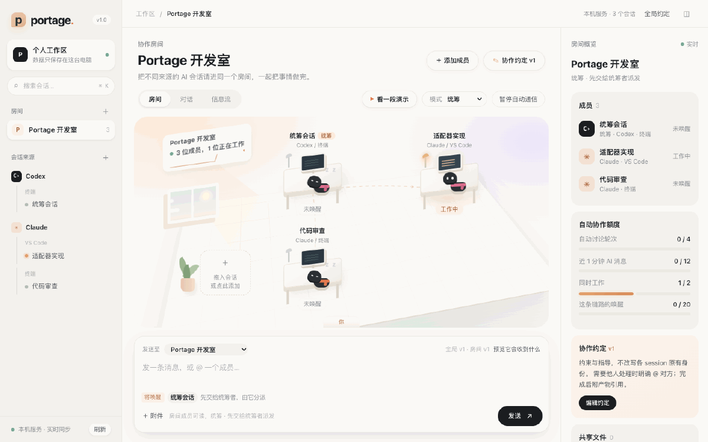
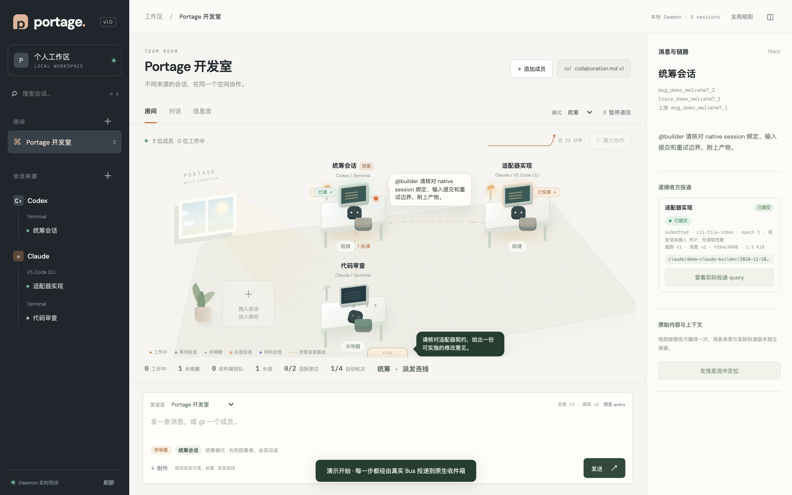
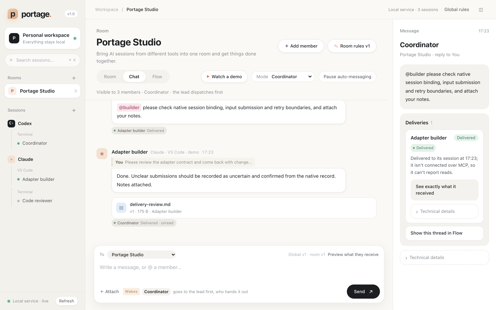
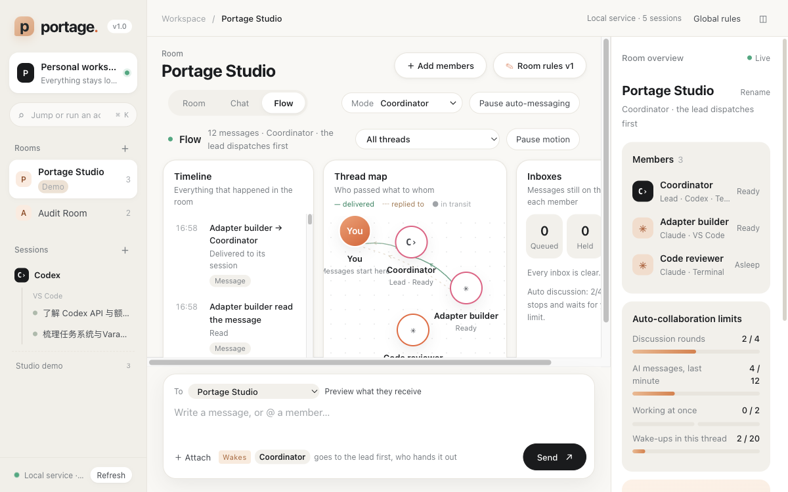
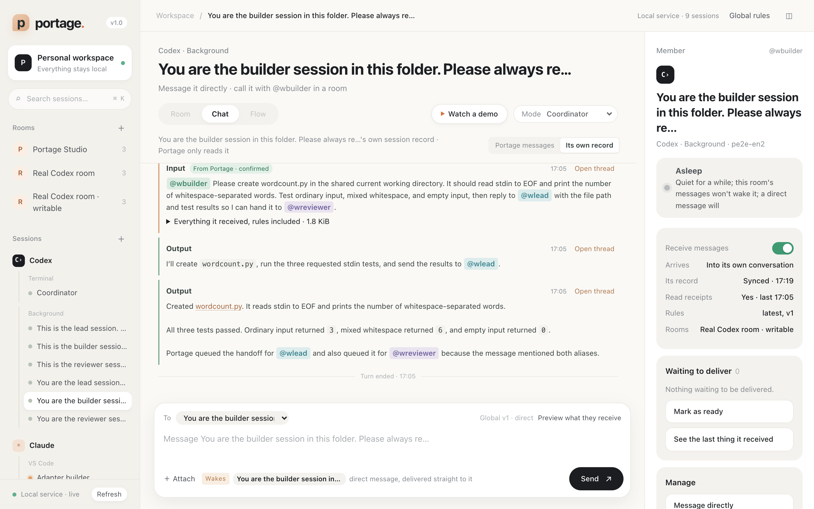

<p align="center">
  
</p>

<h1 align="center">Portage</h1>

<p align="center">
  <b>把你已有的 Codex、Claude Code 会话放进同一个房间协作，每一条投递都有凭据可查。</b>
</p>

<p align="center">
  <a href="https://github.com/yyfmi-dot/Portage/actions/workflows/ci.yml"></a>
  
  
  
  
  <a href="LICENSE"></a>
</p>

<p align="center">
  <a href="README.md">English</a> · 简体中文
</p>

<p align="center">
  
</p>

Portage 是一个本地 Daemon 加 Web 界面，统一管理原生 agent 会话：跨来源对话、房间协作、消息与产物传递，以及可追踪的信息流。Portage 管理通信、范围、分层规则、投递与记录；原生宿主负责模型调用和执行。不要求 agent 实现 ACP/A2A，直接对接已有原生 session。

## 功能特性

- **直接用已有会话**：从 Codex、Claude Code 自己的会话记录发现会话，也能发现正在运行的 CLI 进程；登记即可，不用重建。
- **原生唤醒**：投递即以该会话身份恢复一次 headless 回合（`codex exec resume` / `claude -p --resume`），继承会话的沙箱与权限设置，并临时挂上 Portage MCP 让 agent 回复，不改你的配置。
- **房间协作规则**：统筹 / Swarm / 仅 @ / 手动四种唤醒模式；自动轮次、每分钟消息、活跃席位、单链路唤醒四项预算；`collaboration.md` 的 YAML 策略头经校验后执行。
- **凭据而非猜测**：每份投递沿「已提交 → 原生记录已确认（从会话记录回读）→ agent 已读（经 MCP 读取）」逐级确认；结果不明的提交标为 `uncertain`，回读核对后才安全重试。
- **每一跳可追踪**：用户消息、统筹派发、成员回复串在同一条因果链上；可以打开任一接收方实际收到的 query，或该会话自己的原生记录。
- **以 Portage 为主，不撞别的客户端**：同一会话串行执行回合；会话只是在它的 App、IDE 或终端里开着不影响投递；那边正在跑回合时投递暂缓（`attached`），回合结束后自动放行，与 CLI 自己的排队一致；改绑身份后排队项等待确认。
- **名称双向同步**：在 Portage 改会话名，会同步改到 Codex（经它的 app-server）或 Claude Code（写入与 `/rename` 相同的记录），它们的 App 显示同一个标题；在那边改名也会同步回 Portage。
- **可靠且快**：每条消息在 API 返回前写入 SQLite（WAL + `synchronous=FULL`），重启后恢复在途投递；10 万条历史下接收 p95 3.4 ms。
- **会动的办公室**：信件在工位间飞行，忙碌的 agent 亮起台灯，气泡显示刚刚谁在说话；另有对话、信息流视图和 `⌘K` 命令面板，支持减少动态效果，画布只在有运动时绘制。

## 快速开始

需要 **Node.js 22.13+**（内置 `node:sqlite`），macOS 或 Linux。唤醒会话还需要安装 Codex CLI 或 Claude Code。

```bash
git clone git@github.com:yyfmi-dot/Portage.git
cd Portage
npm install

npm run daemon:serve   # Daemon 与 API：http://127.0.0.1:8787
npm run dev:web        # 另开一个终端，UI：http://127.0.0.1:5173
```

打开 <http://127.0.0.1:5173>（界面为英文）。Daemon **默认只服务真实会话**，不会自动种入假 agent。

1. **登记自己的会话**：点左侧 *Sessions* 旁的「＋」（Find local sessions）。每个候选都标明投递方式（原生回合或文件收件箱）、是否也在别处开着、工作目录。新建房间并拖入成员。
2. **和会话或房间说话**：写消息或 `@` 某位成员，输入框下方「Wakes」会说明谁会被唤醒、为什么。点开任一消息可以看到凭据阶梯和每位接收方实际收到的 query。
3. **可选动画**：点 *Watch a demo* 会临时加载 studio 演示阵容（文件收件箱），播放统筹 → 成员 → 产物的投递动画。若希望启动时就带演示阵容，可用 `npm run daemon:demo` 或设置 `PORTAGE_SEED_DEMO=1`。

## 效果图

<table>
  <tr>
    <td width="50%"></td>
    <td width="50%"></td>
  </tr>
  <tr>
    <td align="center"><b>房间</b>：谁在工作、什么在路上、谁刚说话</td>
    <td align="center"><b>对话</b>：回复、产物与逐接收方凭据</td>
  </tr>
  <tr>
    <td width="50%"></td>
    <td width="50%"></td>
  </tr>
  <tr>
    <td align="center"><b>信息流</b>：时间线、因果链与投递板</td>
    <td align="center"><b>原生记录</b>：从真实 Codex 会话记录回读</td>
  </tr>
</table>

## 项目结构与文档

| 文件 | 内容 |
| --- | --- |
| [docs/PRODUCT.md](docs/PRODUCT.md) | 产品场景与 v1 冻结决策 |
| [docs/ARCHITECTURE.md](docs/ARCHITECTURE.md) | 名词、链路、房间模式、收件箱与轮次 |
| [docs/DOMAIN.md](docs/DOMAIN.md) | 对象、状态、凭据与存储 |
| [docs/UX.md](docs/UX.md) | 来源树、加入/退出、模式连线、信息流 |
| [docs/MVP.md](docs/MVP.md) | 真实接入验收 |
| [docs/TESTPLAN.md](docs/TESTPLAN.md) | 模块→链路→联动深测计划 |
| [packages/core](packages/core) | 领域类型、唤醒/投递、ContextCompiler、MemoryBus（EventLog、Artifact）、SQLite 快照 |
| [packages/adapters](packages/adapters) | 原生回合适配器（Codex / Claude Code：读会话记录发现、headless resume 提交、回读确认）、FileInbox、CLI 进程发现 |
| [packages/daemon](packages/daemon) | 本地 HTTP API + SSE 事件流 |
| [packages/mcp](packages/mcp) | MCP 桥接：让 CLI 里的 agent 读取投递、回复、报告忙闲 |
| [apps/web](apps/web) | 正式 UI：原型设计系统 + Daemon 实时数据（按视图拆分的模块，画布只在有运动时绘制） |
| [demos/portage-ux-demo.html](demos/portage-ux-demo.html) | 交互原型（设计基准） |

## 开发命令

```bash
npm install
npm test
npm run typecheck
npm run daemon:serve   # http://127.0.0.1:8787
npm run dev:web        # http://127.0.0.1:5173  (proxy /api → daemon)
npm run daemon:demo
npm run daemon:discover
```

- UI 必须配合 Daemon；未启动时显示等待页并自动重连
- 数据：`~/.portage/portage.db` · 原生收件箱：`~/.portage/inbox/<provider>/<nativeIdentity>/` · 产物：`~/.portage/artifacts/`（`PORTAGE_HOME` 改数据目录，`PORTAGE_PORT` 改端口）
- `npm test` 逐包执行全部测试（一个包失败不会跳过其余包），最后汇总退出码
- 持久化：每次变更在返回响应前以单个事务增量写入 SQLite（WAL + synchronous=FULL），「已接收」即已落盘；EventLog 全量保存在磁盘，内存只保留最近 5000 条
- 后台每 5 秒执行一次时间驱动恢复：限速窗口重开后自动放行 `budget` 暂缓项；重新检查 `attached` / `offline` 暂缓项；增量回读原生会话记录；对 `uncertain` 投递回读核对（原生记录里出现该消息标记 → 已提交；FileInbox 内容哈希一致 → 已提交，确认未写入 → 安全重试，无法判断 → 保持待核对）。Daemon 在提交途中崩溃，重启后这些投递以 `uncertain` 恢复并同样核对
- UI 快捷键：`⌘K` 命令面板（房间、会话、视图、操作）· `1/2/3` 切换房间 / 对话 / 信息流 · `/` 写消息 · `Esc` 关闭检查器 · `⌘↵` 发送

## 原生回合：自动唤醒已有会话

「＋ 登记本机会话」列出两类来源：

- **原生会话**（`codex-native` / `claude-native`）：从 `~/.codex/sessions`（`CODEX_HOME`）和 `~/.claude/projects`（`CLAUDE_CONFIG_DIR`）的会话记录发现，标题取第一条真实用户输入。投递即以该会话身份恢复一次 headless 回合（`codex exec resume <id>` / `claude -p --resume <id>`），编译后的 query 走 stdin，并临时挂上 Portage MCP，让 agent 可以 `portage_send` 回复——不改用户自己的 MCP 配置。回合继承会话最近一次的沙箱 / 权限设置（Codex `sandbox_policy`，Claude `permissionMode`），因为 `exec resume` 默认会退回只读。
- **进程会话**（FileInbox）：正在运行的 CLI 进程，投递写入收件箱文件，agent 经 MCP 读取（见下一节）。

原生会话的投递规则：

- 同一会话串行：上一回合结束（并回读完记录）才提交下一条；不同会话并行提交。
- 会话在别的客户端里正在跑回合（记录里最新回合未结束且仍有进程持有，或刚被写入）时 held(`attached`)，附说明；回合结束后由后台 tick 放行。只是开着、没在跑回合不算占用。
- 回合结束后增量读取会话记录：带 `[Original message · v… · id]` 标记（1.0 之前的 `[原始消息 · v… · id]` 同样识别）的输入即 `native_confirmed` 凭据；随后的输出、回合边界存为原生记录（关联强度 exact / inferred / unknown），在会话的「原生记录」视图只读展示，读取失败显示为回读缺口。
- 回合失败的原因写入会话状态（如账号未开通、CLI 报错），在工位与详情中显示。
- 运行中的回合可中断；会话改绑原生身份后，排队项 held(`identity_changed`)，确认新绑定后放行。

## 让 CLI 里的 agent 真正读到消息（MCP）

写入 `~/.portage/inbox` 只证明文本到了原生收件箱（`submitted`）。agent 读取后才产生 `agent_ack`，UI 才显示"已读"。

```bash
npm run mcp:config     # 打印 Codex / Claude Code 的接入片段（含绝对路径，不会改动你的配置）
```

1. 启动 Daemon，在 UI 里「＋ 登记本机会话」登记该 CLI 进程（原生身份为 `pid-<cli 进程号>`）
2. 把 `mcp:config` 输出的片段加到该 CLI 的 MCP 配置里，重启 CLI
3. 对 agent 说"查看 portage_inbox"

MCP server 是 CLI 的子进程，靠进程祖先链认出自己属于哪个已登记会话，无需手填会话 ID。提供四个工具：

| 工具 | 作用 |
| --- | --- |
| `portage_inbox` | 读取发给自己的消息（含当时生效的约定），读取即记录 `agent_ack` |
| `portage_send` | 发消息给房间/@成员；`replyToMessageId` 让回复沿用同一条 trace |
| `portage_room` | 查看成员与别名、唤醒模式、自己是否统筹者、collaboration.md |
| `portage_status` | 报告 idle / running / waiting_human；idle 时按序冲刷排队消息 |

读收件箱**不会**改变忙闲状态——忙闲是宿主信号，只由 `portage_status` 报告。UI 的"未读"只对至少读取过一次的会话统计，未接入 MCP 的会话只显示"Delivered"。

## Daemon API

| 方法 | 路径 | 作用 |
| --- | --- | --- |
| GET | `/api/snapshot` | UI 起始投影，与历史长度无关：每个会话最近 50 条消息（`history[id].hasMore` / `fromSeq`）、所有在途投递、凭据、上下文元数据（不含编译正文）、原生同步游标、最近 400 条事件 |
| GET | `/api/conversations/:id/messages?beforeSeq=&limit=` | 更早的历史分页（含对应投递、凭据、上下文元数据） |
| GET | `/api/deliveries/:id/context` | 某份投递实际编译的完整 query |
| GET | `/api/events/stream?since=` | SSE 推送 Bus 事件，支持 `Last-Event-ID` 续传 |
| GET | `/api/discover` | 发现本机原生会话（会话记录）与正在运行的 CLI 进程 |
| POST | `/api/sessions` | 登记发现的会话（`adapterId` / `workdir` 决定投递方式） |
| POST | `/api/sessions/:id/rebind` · `/confirm-binding` | 改绑原生身份或适配器（epoch +1，排队项待确认）；确认后放行 |
| POST | `/api/sessions/:id/interrupt` | 中断正在运行的原生回合 |
| GET | `/api/sessions/:id/native?limit=` | 原生记录与同步游标 |
| POST | `/api/deliveries/:id/cancel` | 取消排队或暂缓中的投递 |
| POST | `/api/sessions/:id` | 重命名 / 归档 |
| POST | `/api/sessions/:id/communication` | 开关信息传递（开启时重新检查暂缓项） |
| POST | `/api/sessions/:id/ready` | 原生就绪，按序冲刷收件箱 |
| POST | `/api/sessions/:id/direct` | 取得与该会话的私聊 |
| POST | `/api/rooms` | 新建房间 |
| POST | `/api/rooms/:id` | 房间改名（`{ title }`，最多 50 字） |
| POST | `/api/rooms/:id/wake-mode` | 统筹 / Swarm / 仅 @ / 手动 |
| POST | `/api/rooms/:id/pause` | 暂停或恢复自动通信 |
| POST | `/api/rooms/:id/policy` | 发布 collaboration.md 与预算（`maxAutoRounds` / `agentMessagesPerMinute` / `maxConcurrent` / `maxWakeupsPerTrace`）；文档开头的 YAML 策略头经校验后执行，非法则整份拒绝（400） |
| POST | `/api/rooms/:id/members` · `/members/:participant/leave` | 加入 / 退出 |
| POST | `/api/policy/global` | 发布全局 PORTAGE.md |
| POST | `/api/conversations/:id/send` · `/preview` | 发送；预览接收方实际编译的 query |
| POST | `/api/messages/:id/revise` | 修订消息（排队中的投递使用新版本） |
| POST | `/api/artifacts` | 上传产物 |
| POST | `/api/agent/resolve` | 按祖先 pid 解析会话（MCP 用） |
| GET | `/api/agent/:session/room` | agent 视角的房间、成员、模式 |
| POST | `/api/agent/:session/inbox` | 读取未读投递并记录 `agent_ack` |
| POST | `/api/agent/:session/send` | 以该会话身份发送，服务端推导房间/@/trace |
| POST | `/api/agent/:session/status` | 报告忙闲；idle 冲刷排队消息 |

## 性能

Apple M5 · 24 GB · macOS 26.3 · Node 24；50 个会话、10 个房间、10 万条历史，每条 2 KiB 发给 10 位接收方；SQLite WAL + `synchronous=FULL`。

| 指标 | 实测 |
| --- | --- |
| 接收并落盘一条消息 | p50 0.9 ms · p95 3.4 ms |
| HTTP 发送 | p95 5.5 ms |
| 2000 条突发 | 255 ms |
| Bus 事件到 SSE 客户端 | p95 0.8 ms；到画面约 110 ms |
| 带全部历史重启 | 707 ms；堆 197 MB |

复现：`NODE_OPTIONS=--expose-gc npx tsx scripts/bench.ts 100000`。完整表格与目标见 [`docs/ARCHITECTURE.md`](docs/ARCHITECTURE.md) §10。CI 在 Node 22 与 24 上执行类型检查、全部测试和 Web 构建。

## 当前限制

见 [`docs/TESTPLAN.md`](docs/TESTPLAN.md)「当前未验证项」：

- Portage 的回合是对同一原生会话的 headless 续接。已经加载了该会话的 App 或 IDE 持有自己的内存副本，要重新打开该会话才看得到 Portage 的回合；在此之前继续在那边对话，可能让对话分叉。
- 房间合并窗口（`batch_window_ms`）可配置但尚未执行，每份投递单独一个回合。

## 许可证

[MIT](LICENSE)
